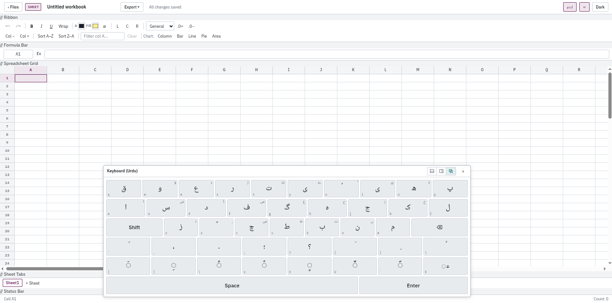

# Deskwork



Deskwork is a browser-based document and spreadsheet workspace built with React and Vite. It supports rich-text editing, spreadsheet formulas and charts, Urdu typing, an on-screen keyboard, local file storage, and document/spreadsheet exports.

## Features

### Documents

- Rich-text editing with bold, italic, underline, alignment, lists, font sizing, and line spacing
- Tables, page breaks, links, find/replace, and document statistics
- Inserted images with inline, left, right, front, or behind text wrapping
- Dragging and resizing of selected images
- A4 and Letter page sizes with portrait and landscape layouts

### Spreadsheets

- 100-row by 26-column editing grid
- Formula support with ranges, arithmetic, comparisons, and built-in functions
- Undo/redo, cut/copy/paste, sorting, filtering, formatting, and column resizing
- Charts based on selected ranges
- Workbook sheets, titles, number formats, currencies, percentages, and dates

### Workspace

- Create, open, duplicate, search, and delete documents or workbooks
- Automatic saving to browser `localStorage`
- Version and cross-tab conflict detection for open files
- Light and dark themes
- English and Urdu typing modes
- Bottom, sidebar, or floating on-screen keyboard layouts

## Export formats

- Documents: DOCX, PDF, JPG, and HTML
- Spreadsheets: XLSX, PDF, JPG, and CSV

Export libraries are loaded on demand from jsDelivr when an export is requested. The application does not include those export libraries as npm dependencies.

## Getting started

### Requirements

- Node.js
- npm

### Install and run

```bash
npm install
npm run dev
```

The development server is available at `http://localhost:5173/`.

### Production build

```bash
npm run build
npm run preview
```

The production build is written to `dist/`.

## Data storage

Deskwork stores application data in browser `localStorage`:

- `files`: file metadata and the recent-file index
- `f:<fileId>`: document or workbook content
- `v:<fileId>`: file version used for autosave conflict detection
- `lang`: selected English or Urdu typing mode
- `theme`: selected application theme
- `kbmode`, `kbopen`, `kbw`, and `kbpos`: keyboard layout and state

Clearing browser storage removes locally saved Deskwork files.

## On-screen keyboard modes

Use the keyboard button in the top bar to open or close the keyboard and choose a layout:

| Mode | Behavior |
| --- | --- |
| Bottom | Fixed to the bottom, centered, with reserved editor space |
| Sidebar | Resizable right-hand panel that fills the available height |
| Floating | Movable panel that remains above the workspace |

Keyboard open state, mode, sidebar width, and floating position are persisted locally.

## Project structure

```text
src/
├── main.jsx                 # React entry point
├── App.jsx                  # Top-level workspace state
├── components/              # Shared UI components
├── screens/                 # Home and editor shells
├── editors/
│   ├── word/                # Rich-text document editor and page helpers
│   └── sheet/               # Spreadsheet grid, formulas, charts, and workbook helpers
├── keyboard/                # Keyboard layouts, Urdu input, settings, and drag behavior
├── hooks/                   # Autosave, file library, and theme hooks
├── lib/                     # Local storage and file persistence helpers
├── export/                  # Lazy library loading and format-specific exporters
├── public/                  # Static public assets
└── styles/                  # Global and feature-specific CSS
```

## Technologies

- React 18
- Vite
- Browser `localStorage`
- DOCX, jsPDF, html2canvas, and ExcelJS loaded lazily in the browser
